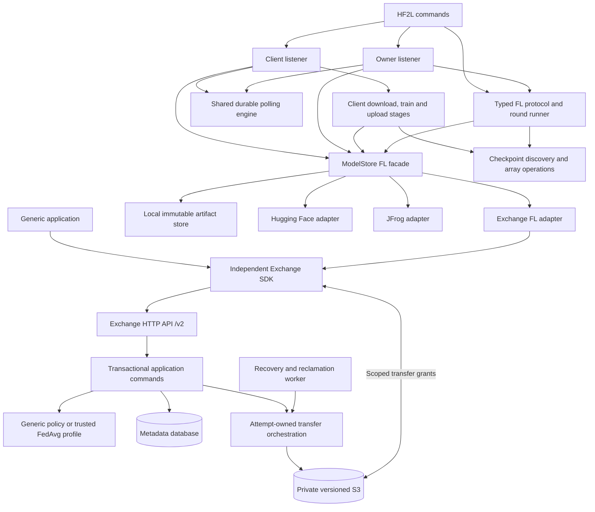

# HF²L architecture v3

V3 combines the generic exchange implementation developed in `hf_fl-v2` with
the useful application boundaries proposed in the current checkout's
[architecture review](history/ARCHITECTURE_REVIEW.md). It is an integration and
maintenance design for this repository, not a third incompatible wire protocol.
The Exchange HTTP API remains `/v2`; existing HF²L manifest versions, filenames
and command aliases remain readable. The Python distributions require Python
3.11 or later. The native Go Exchange service and manager are separate Linux builds requiring
Go 1.26 or later.

This document records the accepted design integrated at `60e4bf8`, subsequent
application and Exchange fixes, the shared client/owner listeners, and the
separately packaged job manager in the current implementation.
The [current implementation limitations](#current-implementation-limitations)
track audit findings and distinguish resolved findings from remaining gaps.
The associated
[Exchange runbook](EXCHANGE_V3.md) distinguishes combined verification results
from earlier sibling-checkout evidence. A design section is not itself proof
that its acceptance tests passed.

## Baselines and implementation provenance

The current checkout started this integration on branch `redesign` at `0564c2b`.
It contained the original HF²L application and Exchange v1 service, plus review
documents and preparatory test artifacts. In particular,
`tests/support/scenarios.md` inventories legacy behaviors; its original empty
coverage column did not mean those behaviors had replacement tests.

The independent `hf_fl-v2` checkout contains an actual implementation of its
[v2 design](history/ARCHITECTURE_REVIEW_AND_V2_DESIGN.md), not only a proposal.
Its source, tests and operational procedures are integrated into the
current checkout. The sibling's historical
[runbook](history/EXCHANGE_V2.md) records its own verification; those counts must
not be reused as evidence for the combined code. The integration was subsequently
committed as `60e4bf8` on `redesign`, rebased onto local `main` (already up to
date), and fast-forward merged into local `main`. That operation did not push,
deploy a service or publish a package.

| V2 design requirement | Incorporated implementation | Verification anchor |
|---|---|---|
| Independent SDK and optional server dependencies | `packages/exchange/pyproject.toml`, `src/hf2l_exchange/client.py` | `packages/exchange/tests/test_boundaries.py`, `scripts/check_exchange_dependencies.py` |
| Generic records, immutable type revisions and separate policy | `hf2l_exchange/application.py`, `models.py`, `schemas.py` | `test_application.py`, `test_integration.py` in the independent package |
| Generic coordination plus optional trusted FedAvg policy | `hf2l_exchange/application.py`, `profiles.py` | `test_foundation.py`, `test_application.py`, `test_integration.py` |
| Owned multipart attempts, exact-version verification and delayed reclamation | `hf2l_exchange/transfers.py`, `storage.py`, `worker.py` | `test_transfers.py`, `test_recovery.py` |
| Durable uncertainty after interrupted provider mutations | Transfer markers and `repair-transfers` in `hf2l_exchange/cli.py` | `test_transfers.py`, `test_recovery.py`, `test_http.py` |
| Explicit schema ledger and command-specific configuration | `hf2l_exchange/migrations.py`, `config.py`, `cli.py` | `test_foundation.py`, `test_http.py` |
| Typed SDK, resumable transfers and token isolation | `client.py`, `client_types.py`, `client_state.py`, `transfer_client.py` | `test_client.py`, `test_integration.py` |
| Explicit HF²L round/acquisition context and publication capabilities | `hf2l/backends/exchange.py`, `hf2l/fedavg_runner.py` | `tests/test_fedavg_v2.py` |

`hf2l_exchange/` paths in this table are relative to
`packages/exchange/src/`. Test names alone do not establish provider or process
coverage; the runbook records which configurations actually ran.

## Decisions from the two reviews

The historical review proposed a complete rewrite with new filenames, manifest
schema 3, a redefined `/v1`, a workflow profile language and one large package.
The sibling v2 independently solved the metadata/blob exchange problem with a
smaller application boundary. V3 selects the following combination.

| Review concept | Decision | V3 implementation or reason |
|---|---|---|
| Generic authenticated metadata and blob service | Accept v2 | Independent `hf2l-exchange`; generic clients use its SDK directly |
| One protocol vocabulary and typed documents | Accept with narrower scope | `hf2l/core/protocol.py` owns FL documents; Exchange owns its separate wire vocabulary; preserve existing formats |
| Replace every backend with a new generic `ArtifactStore` | Defer | `ModelStore` remains an explicit FL facade in `hf2l/core/ports.py`; a second generic abstraction would duplicate the Exchange SDK without a demonstrated caller |
| Explicit capabilities and operation context | Accept | Immutable round/ref/claim values and lazy backend registry; decisions use capabilities rather than backend names |
| Local store and backend contract tests | Accept | A real single-host store provides immutable snapshots, atomic reference preconditions and explicit local participant identity |
| Library runner and thin command edge | Accept | Typed `RoundConfig`, `RoundResult` and reusable `run_round`; diagnostics are data and Python plugin stdout is routed to stderr ([B4](#b4--evaluation-output-can-break-json)) |
| Replace trusted training plugins with a new versioned plugin protocol | Defer | Retain current plugin entry points; typed FL documents and runner boundaries do not require rewriting trusted training code |
| Aggregation algorithm seam | Modify | FedAvg supports examples/uniform weighting and an injected strategy; defer FedProx until its client training semantics are implemented |
| Framework-neutral checkpoint operations | Accept | Header-only layout discovery, NumPy/Torch array implementations and one averaging policy; retain numeric and shard-streaming oracles |
| New filenames, manifest schema 3 and deleted aliases | Reject for this integration | Architecture version 3 does not require breaking published FL documents or operator commands |
| One command entry point | Modify | Add the `hf2l` dispatcher; keep existing console scripts and module entry points |
| JSON workflow profile language supplied by clients | Defer | Generic behavior plus trusted installed `fedavg.v1` supplies the actual use cases without a new policy language |
| Mutable single kind schema | Prefer v2 | Immutable type revisions prevent later registration from silently changing an existing draft's content contract |
| Profile required for all coordination | Prefer v2 | Generic acquisitions accept explicitly selected records without FedAvg vocabulary |
| Atomic publication required of every backend | Modify | Advertise actual guarantees: HF, Exchange and Local can enforce publication preconditions; JFrog requires a single writer and offers a preflight check |
| Replace migrations with `create_all` | Prefer v2 | Preserve the explicit revision ledger, frozen baseline and refusal of incompatible schemas |
| Shared lease abstraction over every resource | Defer | Preserve tested transfer/acquisition ownership rules; do not force their different lifecycles into one abstraction |
| Central filesystem helpers | Accept | `hf2l/common/fs.py` owns reusable operations; `hub_helpers.py` remains a compatibility facade |
| Structured, generated contracts and dependency tests | Accept | Generate API/error/environment artifacts from implemented Exchange sources; verify package and import boundaries |
| Drop Python 3.10 for `StrEnum` | Superseded | The current runtime minimum is Python 3.11; this policy change does not require rewriting existing enums |
| Delete old hardening tests before replacement | Reject | Keep regression oracles and map changed expectations explicitly |
| Additional blob adapters, multiple public identity issuers, general event brokers and push delivery | Defer | One S3 adapter and one configured public identity issuer are implemented; managed workload identities and download brokers have narrower, implemented authorization paths |

These decisions merge concepts rather than combine every class and module from
both proposals. The historical document's open questions and estimated rewrite
schedule do not describe completed work or additional user approvals.

The historical review's twelve themes map to this design as follows: workflow
seams to generic Exchange profiles plus the FL strategy interface; vocabulary to
typed FL documents and generated Exchange contracts; backend size/contracts to
an explicit FL facade, capabilities and LocalStore; owner complexity to the
typed runner; protocol conventions to typed document boundaries while retaining
the plugin contract; framework assumptions to optional imports and array
operations; API/infrastructure complexity to the imported v2 layers and ownership
rules; cross-cutting conventions to common filesystem helpers and structured
results; test architecture to retained oracles and new contract/integration
suites; documentation to this comparison and current generated artifacts. V3
does not claim every lower-priority suggestion in every theme was implemented.

## Component boundaries

Three Python distributions define the installation boundaries:

| Distribution | Code and command | Responsibility |
|---|---|---|
| `hf2l` | `hf2l/`; `hf2l` | FL documents, checkpoint operations, four model backends, client training and owner aggregation, durable polling |
| `hf2l-exchange` | `packages/exchange/src/hf2l_exchange/`; `hf2l-exchange` | Unchanged Python SDK plus reference server for authenticated metadata, blob transfer and coordination |
| `hf2l-jobs` | `packages/jobs/src/hf2l_jobs/`; `hf2l-jobs` | Reference manager implementation and retained sandboxed FL application adapters |

The native Go Exchange is built from `packages/exchange/cmd/hf2l-exchange`
using `packages/exchange/go.mod`. Its API, authorization, persistence,
versioned-S3 transfer lifecycle, worker, repair tooling, managed ingress, and
private gateway backend are native Go; it uses no Python Exchange bridge and
executes no ML code. The Python SDK stays independently usable by Org P and
participants. The [Go Exchange guide](GO_EXCHANGE.md) covers build, TLS,
Draft 2020-12 schema/regex compatibility preflight, and explicit cutover.
Shared protocol/schema compatibility does not automatically qualify a deployment.

The native Go manager is built from `packages/jobs/cmd/hf2l-jobs` using
`packages/jobs/go.mod`. Its `internal/` packages implement the trusted control
plane: HTTP/OIDC, persistence and administration, scheduling, lifecycle,
provisioning, qualified execution/node services, participant services,
gateways/proxies, collection, and retention. It embeds the existing browser
assets; it does not delegate manager policy or lifecycle to a Python RPC/API.
The independent Exchange service stays a separate deployment. Existing
sandboxed Python training/build adapters retain their application validation
and fixed worker-command contract.

Go and reference Python implementations share the current manager schema and
external contracts. Select one controller and reconcile retained state before
cutover; cross-language unit/SQL compatibility does not establish a new
deployment's runtime qualification. See the [Go manager guide](GO_JOB_MANAGER.md)
for build, private transfer-backend integration, verification, and rollback
boundaries.

The core FL workflows can run against Hugging Face, JFrog or LocalStore without
deploying Exchange or the job manager. The root's `exchange` extra installs the
independent SDK; server dependencies are optional. Managed jobs compose the FL
application and Exchange with their own control-plane database, per-job spaces,
workload identities and execution state. The diagram below expands the FL and
Exchange paths; it does not depict the job manager's service topology. See the
[job manager guide](JOB_MANAGER.md) and [deployment topology](../deploy/jobs/README.md)
for that separately configured boundary.



The generic exchange neither imports HF²L nor installs its ML libraries. Its
domain contracts are independent of HTTP and persistence; application commands
own transactions and authorization; HTTP parses and renders; storage translates
provider errors; the worker uses the same ownership rules as API requests.
There is one metadata service and one recovery worker, not a new microservice
for every layer.

The [call sequence diagrams](diagrams/README.md) trace upload, download, and an
owner-controlled FedAvg round through these components. Editable Mermaid sources
and an offline HTML rendering are included.

HF²L `common` contains reusable filesystem operations. `core` contains typed FL
protocol values and the FL store port. Backends implement that port, while the
runner owns selection, checkpoint validation, averaging and publication. The
Exchange adapter translates FL operations into generic records and coordination.
Generic applications do not pass through `ModelStore`.

The [listeners](CLIENT_LISTENER.md) share the provider-independent
`DurableListener` engine in `hf2l/listener/engine.py`, which owns locking, durable
progress, polling, and retry pacing. The client controller composes download,
training, and upload through `hf2l/listener/workflow.py`. The owner controller
checks readiness and invokes `FedAvgRunner`; its publication hook persists
intent immediately before the backend operation. `hf2l/cli/listen.py` selects
the role and loads credentials and trusted plugins. Both use the existing store
port without adding backend-specific event handling or FL scheduling to the
generic Exchange service.

The root distribution installs NumPy and SafeTensors. Torch and Hugging Face are
optional extras loaded at the point of use. NumPy handles supported non-BF16
checkpoints; BF16 requires the Torch backend. Training examples require their
training dependencies. The independent SDK has HTTPX as its runtime dependency;
its server extra adds database, web, storage and identity libraries.

## Core contracts and invariants

### Metadata, policy and coordination

Public Exchange requests authenticate an access token from the configured
external OIDC identity provider. The validator requires an RS256 `at+jwt`
token, verifies its issuer, audience, signature, expiry and required claims,
and requires the `exchange` scope. A stable principal derives from issuer and
subject; a caller-supplied participant string does not establish identity.
In a `fedavg.v1` space, administrators bind memberships to participant IDs,
and the service attributes updates from that binding. The FL adapter verifies
the requested participant and downloaded manifest against the server binding.

Managed workload authentication is a separate ingress path: a trusted TLS
terminator authenticates the client certificate and signs a short-lived backend
assertion. The service validates that assertion, the workload JWT and its
certificate binding, then checks the current persisted grant, roles, space,
job, attempt and epoch. The public ingress rejects workload tokens. Managed
download brokers have explicit authorization and an effective reader role;
their allowlist does not grant space membership. See the [Exchange runbook](EXCHANGE_V3.md)
for deployment requirements and managed transfer routing.

A space is the authorization and quota boundary. `reader`, `contributor`,
`publisher` and `admin` are explicit roles; administration alone does not grant
content access. Revocation blocks new content access and signed grants. It does
not invalidate an already issued bearer URL before that URL expires.

A draft pins an immutable type revision. Current kind policy and membership are
checked independently, including at publication. Published metadata and verified
attachment identities are immutable. Generic records require no participant,
training base, model filename or FedAvg kind.

References use an explicit generation precondition and do not have a
delete/recreate path that resets their generations. A profile protects only its
chosen references; generic spaces can use `main` for arbitrary content.
Acquisitions freeze explicit inputs and a reference generation, have renewable
fenced ownership, and allow at most one active acquisition per space/reference.
Successful completion updates the result, reference and event history atomically;
replay returns the recorded outcome.

The optional FedAvg profile adds participant attribution, shared model results,
protected `main` advancement and provenance checks. Automatic selection uses the
newest eligible submission per participant. Automatic aggregation may reject
malformed candidates and use a valid frozen subset of at least two; explicit
selection failures remain errors. Legacy inventory expectation S-050, which
aborted a whole automatic round for a shape-invalid input, is superseded by this
documented behavior. Check-only readiness inspects metadata; full aggregation
checks checkpoint compatibility, individual finite values and accumulator
conversion, and verifies required schema-2 hashes and any supplied schema-1
hashes before publication ([B6](#b6--owner-hash-verification-is-limited-to-schema-2)).
An invalid global base or reduction overflow fails the round. Custom aggregators
may implement the optional `validate_input` hook; their reduction policy remains
their responsibility.

### Blob transfer and recovery

The Exchange storage seam is `BlobStore` in
[storage.py](../packages/exchange/src/hf2l_exchange/storage.py); the shipped
implementation is `S3BlobStore` with the `s3-multipart-v1` protocol.
AWS S3, MinIO and compatible services are deployment choices for that adapter,
not three independent storage implementations. They must supply the required
versioning, multipart, signing and deletion semantics. Compatibility evidence
for one service or version does not qualify another. The
[Exchange runbook](EXCHANGE_V3.md) records provider-specific requirements.

1. Reserve declared metadata and capacity before provider I/O. A size/hash
   declaration is not verification; publication requires the exact verified
   object version.
2. Each attempt owns its storage key and multipart handle. Database leases fence
   database commits; they cannot cancel remote storage side effects.
3. Provider I/O runs outside the space mutation transaction. Commit and release
   paths verify ownership on the database clock and cannot overwrite a successor.
4. Persist a separate mutation marker before initiating or completing provider
   work. A lost callback keeps the outcome uncertain even after the lease expires.
5. Cancellation moves bytes to pending reclamation. Scheduled cleanup waits for
   issued grants to expire. Deletion sweeps may run while provider mutation
   markers remain, but cleanup cannot commit completion or release capacity
   until those markers are cleared. Metadata purge also remains blocked while
   an attempt could still create objects.
6. Uncertain orphan mutations have a bounded inspection and offline repair path.
   An operator must stop all writers and independently establish provider
   quiescence before clearing markers. Repair schedules recovery or cleanup; it
   does not declare remote deletion successful.
7. Persist SDK operation state before a creating request. Resume confirmed
   multipart parts and interrupted downloads; use a credential-free transfer
   client for signed URLs and verify final size/hash.

Blob capacity includes pending deletion. Retained-record and canonical-metadata
quotas also bound metadata-only growth. Terminal records continue consuming those
budgets until explicit eligible purge. Coordination provenance remains retained;
there is no history-erasure API. Cancellation and cleanup must remain possible
when an admission quota is exhausted.

Events form a retained authorized pull feed. Consumers persist cursors,
deduplicate, process terminal tombstones and reconcile after cursor expiry. This
is not a webhook delivery system. Event/idempotency retention is bounded; replay
after retention expires can create a new operation.

### FL documents, checkpoints and publication

Typed readers and writers own the accepted manifest versions and filenames.
Parsing validates immutable base identity, participant attribution, example
counts and the shape of declared checkpoint hashes. Byte verification is a
separate step: the owner and client verify required schema-2 hash maps and any
supplied schema-1 maps ([B6](#b6--owner-hash-verification-is-limited-to-schema-2)).
Schema-1 documents without hashes remain readable without digest verification.
Compatibility exports remain available
while production callers use the canonical modules.

Explicit cyclic client mode accepts an immutable global model or predecessor
submission. Contexts and submissions carry a global root and ordered lineage;
validation checks repository/backend, participant, immutable revisions,
checkpoint compatibility and predecessor digests. All predecessor submissions
require complete checksum maps. The root and at most 64 predecessor snapshots
must remain accessible: download and upload validation fetch their checkpoints,
so transfer and disk costs grow with lineage length. The caller chooses each
handoff and participant order; no automated swarm scheduler or unique-successor
guarantee is supplied. Synchronous FedAvg rejects cyclic-marked submissions,
and listeners continue processing global FedAvg rounds. Exchange peer reads
require an explicit shared-update policy. See the
[manual cyclic workflow](TRAINING_GUIDE.md#cyclic-federated-learning-without-fedavg).

When supplied, `algorithm_spec` propagates from the round to client context and
submission. The owner checks its name, version and client-affecting parameters
using recursive JSON value comparison that distinguishes booleans from numbers
at every depth ([B5](#b5--algorithm-parameter-equality-is-not-json-type-aware)).
Equivalent finite integer/float values compare numerically, object key order is
ignored, and array order remains significant.
FedAvg declares weighting a server-only parameter: switching examples/uniform
weighting does not require clients to retrain. A legacy descriptive `algorithm`
string alone is not a structured algorithm identity. Custom strategies must
declare any server-only parameters explicitly; client-affecting parameters still
participate in eligibility checks.

Reference snapshots, round context and claim handles are explicit arguments.
The run-state file belongs to one logical operation, survives interrupted
responses and is distinct from the published model directory. The Exchange
runner persists its claim handle and starts renewal before reading acquired
input metadata. Recovery can replace a saved acquisition key only after the
service confirms that the prior acquisition cannot publish; completed or
uncertain publication requires reconciliation
([B3](#b3--same-state-acquisition-retry-can-get-stuck)). A claim renewer protects
input metadata reads, long downloads and averaging; ownership loss prevents
publication.

Checkpoint discovery reads and validates SafeTensors headers, index membership,
tensor names, shapes, dtypes and safe paths without importing Torch. Averaging
has one policy implementation over array operations: finite values are required,
non-floating tensors must agree, coefficients are validated and accumulation
rules remain explicit. Numeric goldens and streaming tests verify behavior;
NumPy/Torch differences require measured tolerance rather than an unqualified
bit-identity claim across CPUs.

The four implementations share `ModelStore`, but their capabilities differ:

| Backend | Aggregate publication precondition | Coordination and submission behavior |
|---|---|---|
| Hugging Face | Conditional commit against the expected parent | Commit ancestry and pull-request submissions; a configured owner allowlist maps authors to participants |
| JFrog | Preflight comparison only; one publishing coordinator required | Named submission revisions; server overwrite restrictions remain necessary |
| Exchange | Atomic reference-generation update during acquisition completion | Renewable fenced acquisitions and server-bound participants; publication requires coordination |
| LocalStore | Atomic reference comparison under a POSIX advisory lock | Named immutable snapshots and an explicit local principal; trusted single-host filesystem |

Backend replacement therefore requires matching the workflow's required
capabilities, identity configuration and submission selection. Automatic discovery
without an allowlist on a backend that does not bind participants emits a warning
and accepts compatible submissions; the shipped HF webhook workflow requires an
allowlist. Shared download,
training, listener and runner interfaces do not establish identical concurrency
or authorization guarantees. See
[ports.py](../hf2l/core/ports.py) and the
[installed registry](../hf2l/backends/factory.py) for the capability and factory contracts.

The local backend is a single-host POSIX implementation with immutable artifact
snapshots and atomic reference checks under an advisory filesystem lock. An
explicit local principal provides participant attribution; it is not remote
authentication. Filesystem access controls protect the store. It is not a
network service or a multi-host filesystem coordination guarantee.
All writers must use the adapter's locking protocol. Reserved revision names
cannot be shadowed by tags, downloads cannot target the storage namespace, and
atomic destination replacement prevents a pre-existing hard link from mutating
an immutable snapshot. Publication persists snapshot data before advancing a
reference. Source symlinks, path escapes and colliding artifact paths are refused.

A confirmed primary publication stays successful if a subsequent tag operation
fails. The result carries the committed revision and a separate warning. An
uncertain primary response requires reconciliation; blindly retrying a new
publication is unsafe. JFrog's documented single-writer restriction remains;
its direct submission and tag APIs reject reserved mutable aliases before
provider operations ([B7](#b7--jfrog-direct-submission-can-target-main)).
Automatic discovery can skip a malformed or deleted candidate; a backend outage
propagates as a round failure instead of being silently treated as an invalid
participant submission. HF/JFrog contract tests use deterministic SDK doubles;
they do not establish live remote-provider behavior.

<a id="per-client-round-listener"></a>

### Client and owner round listeners

`hf2l listen` supports Hugging Face, JFrog, Exchange and LocalStore by polling
`ModelStore.resolve_reference`, normally for `main`. It probes the round metadata
before downloading a new checkpoint, pins the immutable revision, and uses the
existing checkpoint validation and trusted `train_model` plugin contract. It
rechecks the reference before training and upload. Owner-side common-base
validation still decides whether a racing submission is eligible. The default
`--role client` preserves existing commands and saved client state.

`--role owner` watches `main` and repeatedly checks submission metadata even
when that reference has not changed. Once enough distinct eligible participants
share the current immutable base, the owner invokes the same runner used by
manual aggregation. The runner revalidates all inputs, downloads checkpoints,
aggregates, optionally evaluates, and publishes. Exchange uses a renewable
fenced claim, Hugging Face and Local use conditional publication, and JFrog
requires one publishing coordinator. Client and owner workflows share durable
polling mechanics without combining their credentials or permissions.

The owner and each participant have separate durable state directories, protected by POSIX
advisory lock. State records pending work and completed revisions/round numbers,
so a restart or metadata-only commit does not repeat a completed round. Safe
download, training, and aggregation failures retry with bounded backoff. A durable
publication marker precedes each remote write; a possibly accepted submission
or global publication stops for explicit operator reconciliation. The owner
retains Exchange acquisition state across fresh attempts, and cleans up failed
prepublication output on retry. Completed and uncertain artifacts support
recovery. These local records do not provide exactly-once
remote publication or coordinate duplicate listeners using different directories.

Startup and reconnect reconcile the current reference, including an unprocessed
initial round. Polling can skip rounds published while a client was offline;
there is no replay queue of obsolete rounds. Neither role consumes the Exchange
event feed or implements SSE. The owner listener and the existing HF webhook
workflow provide separate scheduling options. Run a listener continuously for
prompt readiness checks, or schedule `--once` invocations that reuse its state.
`--max-rounds` counts successful work during the current invocation.

See [the listener guide](CLIENT_LISTENER.md) for commands, state identity,
bounded execution, the Python extension API, and uncertain-publication recovery.

### Training plugins, data and approval boundaries

Standalone `hf2l train` and the client listener load trusted local
Python plugins. The training entry point is
`train_model(base_dir, output_dir, options)`: it writes a compatible checkpoint
to `output_dir` and returns a JSON metadata dictionary with a positive integer
`num_examples`. Dataset access belongs to the plugin and its local configuration.
The owner can optionally invoke the plugin's evaluation entry point.
See the [training guide](TRAINING_GUIDE.md) for complete callable contracts.

The FL application transfers model checkpoints, manifests and declared metadata;
it does not automatically upload a participant's raw dataset. Standalone plugins
run with the invoking process's filesystem, credentials and network access.
The workflow does not sandbox that code or prevent a plugin from placing sensitive
data into a checkpoint, metadata or logs. Checkpoint exchange alone also does not
provide differential privacy, secure aggregation or model-poisoning resistance.

Managed execution adds a separate qualified Linux CPU sandbox profile,
`runsc-cpu-v1`. Job specifications cannot choose arbitrary mounts, networking,
runtimes or flags; the executor checks the qualified runtime and resource limits,
uses network isolation with a mediated local proxy, and authorizes each participant's
dataset binding. These controls require the documented deployment setup and
qualification; installing the package alone does not establish isolation.
GPU and Kubernetes execution need separate qualification. A dataset's local
mount and network restrictions do not prove that training outputs reveal no
information about that dataset.

Native client and owner listeners automate polling, training, readiness and
aggregation. The Hugging Face [webhook workflow](../.github/workflows/fed_avg.yml)
offers another owner trigger: `repository_dispatch` with `hf-pr-update`, or a
manual workflow dispatch, followed by readiness checks and conditional publication.
An external webhook receiver must arrange the repository dispatch. Exchange does
not send that trigger.

Public HF²L commands do not implement `approve`, `--require-approval`, or
human approval receipts before training or publication. A deployment can add
an external human approval step. That step is separate from mandatory
authorization: Exchange memberships and policy, configured owner participant allowlists,
and managed source, image, dataset and workload grants still apply when automated
execution is enabled.

## Current implementation limitations

The documentation/implementation audit of `60e4bf8` confirmed the eight findings
below. The current implementation addresses them within the scopes stated in
each section: cyclic handoffs are explicit manual operations, and plugin output
routing covers Python stdout. Earlier full-suite passes do not establish that
these gaps were absent then. The original finding headings are retained for
stable links. Deployment and provider validation limits remain below.

### B1 — Cyclic submission handoffs are unsupported

**Resolved for explicit manual handoffs.**
[Client download and upload](../hf2l/client_steps.py) distinguish global-model
and submission sources when `--workflow cyclic` is selected. The predecessor's
manifest and complete digest map determine checkpoint validation, and immutable
lineage leads back to a validated global root. Upload revalidates that source and
its ancestry before publishing the new cyclic-marked submission. Ordinary
FedAvg commands continue using global round records and reject cyclic updates.
The [manual recipe](TRAINING_GUIDE.md#cyclic-federated-learning-without-fedavg) describes
participant order, the 64-predecessor bound, snapshot access and transfer costs.
Automated cyclic/swarm scheduling and one-successor enforcement are not
implemented. Exchange private updates remain private unless an administrator
explicitly changes their publication policy for peer handoffs.

### B2 — AWS environment session tokens are dropped

**Resolved.**
[Storage configuration](../packages/exchange/src/hf2l_exchange/config.py) leaves
ambient AWS credentials to Boto's provider chain, preserving session tokens and
refreshable credential providers. Explicit `EXCHANGE_S3_ACCESS_KEY` and
`EXCHANGE_S3_SECRET_KEY` must be supplied together; temporary explicit credentials
also use `EXCHANGE_S3_SESSION_TOKEN`. The
[S3 client factory](../packages/exchange/src/hf2l_exchange/storage.py) applies the
same credential configuration to internal clients and public-endpoint signers.
See the [runbook](EXCHANGE_V3.md) for configuration details.

### B3 — Same-state acquisition retry can get stuck

**Resolved.**
[ExchangeStore.acquire_claim](../hf2l/backends/exchange.py) returns the owned
handle before reading input metadata. The [runner](../hf2l/fedavg_runner.py)
persists that handle and starts renewal before requesting the input descriptors.
A metadata failure therefore follows normal runner cleanup: confirmed
abandonment clears run-state, while a failed or uncertain abandonment preserves
the saved handle and key for reconciliation or retry.

On retry, only confirmed abandonment or expiry permits replacing the saved key,
including terminal replay responses for older key-only state files. An explicit
`--claim-id` is never replaced automatically. A completed acquisition or uncertain
publication preserves the state and requires reconciliation before another
logical operation; transport errors alone do not authorize a replacement key.

### B4 — Evaluation output can break JSON

**Resolved for Python plugin stdout.** The
[runner](../hf2l/fedavg_runner.py) returns diagnostics in `RoundResult` and routes
Python stdout during plugin imports and evaluation to stderr. Initialization,
training commands, and listener training use the same
[plugin output context](../hf2l/common/output.py). Built-in model-loader and
epoch progress therefore leave `--json` results and listener events readable
on stdout. Exceptions restore the original stream. The redirection temporarily
changes Python's process-wide stream; library callers must avoid concurrent
unrelated stdout writers during a plugin call. Direct file-descriptor writes
and subprocess output are outside this guarantee.

### B5 — Algorithm parameter equality is not JSON-type-aware

**Resolved.** After excluding declared server-only parameters, the
[runner's eligibility check](../hf2l/fedavg_runner.py) uses
[recursive JSON value comparison](../hf2l/core/json_values.py). It distinguishes
JSON booleans from numbers in nested objects and arrays, retains numeric
equivalence for finite integers/floats, ignores object key order, and preserves
array order. Non-JSON and non-finite values are rejected by document validation
and the comparator.

### B6 — Owner hash verification is limited to schema 2

**Resolved.** The [owner runner](../hf2l/fedavg_runner.py) and
[client download](../hf2l/client_steps.py) verify required schema-2 checksum maps
and any supplied schema-1 maps. A supplied schema-1 map cannot bypass byte
verification, for either the global base or a submission. Schema-1 documents
without hashes remain accepted without digest verification; current writers
produce schema-2 documents with required hashes.

### B7 — JFrog direct submission can target main

**Resolved.** [JFrogStore](../hf2l/backends/jfrog.py) rejects `main`, `master`,
`HEAD`, `latest`, and `default`, ignoring case, as submission revisions or
aggregate tags before provider reads or writes. Valid detached revision names
and ordinary round tags remain supported. Server-side overwrite restrictions
and one publishing coordinator are still required: name validation does not
provide atomic publication or prevent replacement of a permitted revision.

### B8 — Verification slots are not isolated from cleanup races

**Resolved.** The
[worker](../packages/exchange/src/hf2l_exchange/worker.py) dispatches verification
and cleanup to separate pools.
[Transfers.process](../packages/exchange/src/hf2l_exchange/transfers.py) now checks
the requested category against the refreshed attempt state while acquiring its
lease under the same space lock used by lifecycle mutations. A category mismatch
is skipped without acquiring a lease, so a cancellation between selection and
dispatch cannot move cleanup into a verification slot. Cancellation after lease
acquisition remains subject to existing lifecycle fencing. The Python reference worker still
waits for both selected batches before its next pass; slow cleanup can delay
subsequent verification batches.

## Integration and compatibility

Exchange v2 requires a fresh metadata database and storage prefix. It neither
serves `/v1` nor imports legacy Exchange data. V3 keeps this deployment rule and
does not reinterpret the old service's database.

The old `hf2l.exchange` service and its command remain available as a clearly
identified legacy surface for regression and explicit legacy use. New
`--backend exchange` application operations use the independent `/v2` service.
Do not point that adapter at the old service. Existing HF/JFrog document formats,
module entry points and console aliases remain supported during this integration.

The unified `hf2l` command composes existing client/owner tools; service commands
remain available through `hf2l-exchange`. Package version, architecture revision,
HTTP version, database revision, manifest schema and profile version are separate
identifiers. This change creates no release or compatibility promise for a future
schema change.

## Acceptance and verification

Generated contract files are checked against their source generators:

```bash
.venv/bin/hf2l-exchange export-contract --output-dir docs/generated
.venv/bin/hf2l export-contract --output docs/generated/fl-documents.json
```

The Exchange command emits `exchange-api.json`, `exchange-errors.json` and
`exchange-environment.md` without IdP or S3 configuration. The FL command emits
the accepted document schemas. These artifacts describe actual interfaces;
they do not introduce a new manifest version. OpenAPI reflects declared routes
and request schemas; currently untyped response bodies are not a complete set of
generated response DTOs. The error artifact records literal error/status pairs
and identifies dynamic forwarding sites; it does not claim every possible
provider or forwarded error is statically enumerated. FastAPI's default
validation models remain visible in the generated API document.

Programmatic orchestration uses the typed runner rather than constructing argv:

```python
from pathlib import Path
from hf2l.fedavg_runner import run_round
from hf2l.round.config import RoundConfig

result = run_round(store, RoundConfig(
    repo_id="example/model", output_dir=Path("work/round-1"),
    selection="discover", weighting="examples", array_backend="numpy",
))
summary = result.to_dict()
```

`RoundResult` reports readiness/aggregation/publication status, eligible and
skipped candidates, warnings and any confirmed publication. An application can
pass an `Aggregator` implementation through `run_round(..., aggregator=...)`;
its coefficients and reduction behavior remain explicit. The CLI renders that
structured result with `--json`; Python stdout from plugin imports and evaluation
is routed to stderr, with the concurrency and direct-I/O limits described in
[B4](#b4--evaluation-output-can-break-json).

| Boundary | Required evidence |
|---|---|
| Generic use | Metadata-only and arbitrary-file exchanges without model vocabulary; generic and FedAvg spaces coexist |
| Policy | Role matrix, revoked members, current-policy publication checks, protected-reference non-bypass and terminal visibility |
| Type evolution | New schema registration affects new drafts while existing records retain their pinned revision |
| Transfers | Exact versions, multipart resume, credential isolation, delayed cleanup, lost callbacks and safe offline repair |
| Coordination | Competing CAS writers, stale fence refusal, completion replay, subset provenance and process interruption |
| FL contracts | Typed document round trips, invalid input rejection, legacy versions, common immutable base and participant binding |
| Backend behavior | Local/HF/JFrog/Exchange capabilities, publication preconditions, confirmed primary plus failed tag |
| Shared listeners | All-backend client/owner polling, metadata readiness on unchanged bases, pinned-round validation, stale-job refusal, restart deduplication, state exclusion, retry backoff, and uncertain-publication recovery |
| Numeric behavior | Existing goldens, finite/non-floating rules, NumPy/Torch comparison and bounded shard streaming |
| Packaging | Fresh minimal root/SDK/server/manager environments, lazy optional imports, all three distributions and dependency checks |
| Integration | Root regression suite plus independent Exchange suite with SQLite/Moto and PostgreSQL/MinIO; separate jobs suite, packaging gates and qualified CPU execution evidence |
| Documentation | Generated contracts match implemented sources; commands/examples execute; historical claims are labeled |

The table records required evidence, not a claim that every intended guarantee
has been met. The scope and operational limits of the fixes above remain
relevant even when a local suite passes; the dated validation records describe
which configurations actually ran.

The original golden fixtures and behavior inventory are retained as evidence
sources. Each replaced or changed behavior needs a current test mapping or an
explicit superseded/deferred explanation. The repository need not discard
working old regression tests to achieve clean new package boundaries.

Current combined run results are linked from [EXCHANGE_V3.md](EXCHANGE_V3.md);
the [October 8 remediation record](validation/2026-10-08-repository-remediation.md)
records verification of the current fixes.
Local tests do not establish production throughput, live Hugging Face/JFrog
behavior, TLS/IAM/identity configuration, backup/restore objectives or remote CI
status. Those claims need separate deployment or provider evidence.
