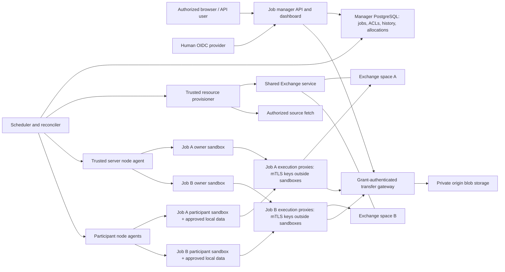
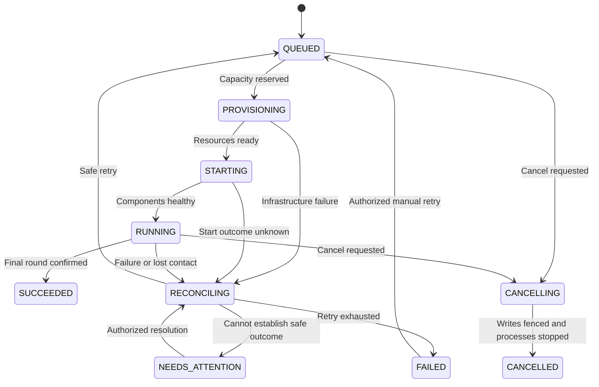

# Multiple federated learning jobs in one HF²L deployment

**Status:** CPU v1 interfaces are implemented; each deployment needs runtime qualification and operational acceptance.

The manager package, PostgreSQL queue and history, OIDC authorization, dashboard, workload grants, managed Exchange transfer path, source provisioning, and Linux CPU executor are implemented. The [operator guide](JOB_MANAGER.md) and [deployment guide](../deploy/jobs/README.md) describe their current configuration. The [validation report](validation/2026-10-09-multi-job-implementation.md) preserves historical evidence and its tested topology, versions, failures, and limits. That evidence does not qualify a different host, image, runtime policy, or production identity/storage provider.

Managed execution currently supports the qualified, networkless `runsc-cpu-v1` profile. Standalone native GPU training is a separate workflow; it does not establish managed GPU support. Kubernetes execution, managed GPU execution, pause, preemption, mid-epoch optimizer resume, and shared GPU allocation remain outside the implemented CPU executor.

The contracts below describe implemented behavior and required deployment acceptance. The delivery checklist is an acceptance framework, not a claim that every scenario has passed in every deployment.

## 1. Goal and current implementation

One deployment must accept multiple independent training jobs, run those that fit available resources, and queue the rest. A job owns its code snapshot, model repository, Exchange space, identities, working directories, listener state, logs, and artifacts. Code executing for job A must not read, write, discover, or publish into job B, including when the same human submits both jobs.

Authorized users need a dashboard and API for current, queued, and historical jobs. The manager creates required resources, schedules execution, records progress, cancels work, reconciles failures, and removes temporary resources. Historical access follows current authorization.

The existing deployment already has useful building blocks:

| Existing behavior | Design consequence |
| --- | --- |
| The owner listener fixes its reference to `main` and binds state to one repository/configuration ([owner listener](../hf2l/listener/owner.py)). | Run a separate owner and isolated repository/space for each managed job. |
| Listener `max_rounds` counts successes in the current invocation ([listener engine](../hf2l/listener/engine.py)). | Persist an absolute final round so restarts cannot extend a job accidentally. |
| Publication intent and uncertain outcomes stop owner/client replay ([owner](../hf2l/listener/owner.py), [client](../hf2l/listener/client.py)). | Reuse this safety boundary; never turn an unknown publication into a blind retry. |
| Exchange checks current membership inside the space transaction ([application service](../packages/exchange/src/hf2l_exchange/application.py)). | Retain membership checks and add a narrower workload grant check. |
| Exchange supports separate human and optional workload issuer/audience validation with current grant checks ([authentication](../packages/exchange/src/hf2l_exchange/auth.py)). | Configure the managed issuer/audience explicitly and use certificate-bound execution grants through the dedicated ingress. |
| The built-in trainer creates an optimizer for each training call ([training](../hf2l/training.py)). | Recovery resumes from durable round boundaries; mid-epoch optimizer resume is outside v1. |

V1 manages FedAvg jobs using fresh `fedavg.v1` Exchange spaces for model artifacts. Existing LocalStore, Hugging Face, JFrog, and manual cyclic workflows remain available independently; their adapters must establish equivalent job-scoped credentials and egress before becoming managed isolation targets. Automatic cyclic scheduling is a later workflow adapter.

## 2. Architecture and ownership

The implementation provides an independently packaged Python distribution `hf2l-jobs`, import package `hf2l_jobs`, under `packages/jobs`, requiring Python 3.11 or later. It uses FastAPI, SQLAlchemy, and PostgreSQL and serves packaged HTML/CSS/JavaScript from the manager; dashboard development and deployment do not require Node.js.

The manager controls metadata, policy, and desired lifecycle. Control-plane processes never import or execute job plugins, package builds, model loading, or checkpoint deserialization; those operations run inside the job sandbox. A scheduler reserves capacity transactionally. A reconciler compares desired state with durable resource ownership and runtime observations. A trusted provisioner creates spaces, source snapshots, identities, and grants. A trusted node agent launches and stops approved sandbox specifications; it accepts no arbitrary host command, mount, runtime flag, or Docker socket instruction from a job.

The Exchange service remains a shared generic metadata/blob service. It does not import the manager, schedule work, or query the manager database. Each job gets a new manager-allocated space, policy, immutable source checkout, and initial global model. “Repository” here means the job's isolated source/model workspace; v1 does not create a new GitHub repository for every job. Job inputs cannot select an existing foreign space or host directory.

Participant training and raw data stay on participant machines. Registered managed agents advertise locally approved pools and accept resource-accounted assignments for several jobs; autonomous external participants join without a manager allocation. Both use isolated job-specific clients. Participants approve dataset bindings locally. The manager coordinates owners and assignments, and observes readiness; it never receives raw participant datasets.

Define `Executor.reserve/start/inspect/stop/collect/release` operations with durable job/attempt/component identifiers and fencing epochs. The first implementation uses Linux node agents and an OCI sandbox runtime. Trusted collection treats sandbox-generated names and outputs as untrusted: open only regular files beneath the component-owned volume using descriptor-relative, no-symlink traversal; reject traversal and hard-link escapes. Bound log/event sizes and never unpack archives, load models, or execute output in the control plane. A later Kubernetes executor must preserve these contracts and isolation tests; Kubernetes namespaces alone are insufficient to establish this application's isolation policy. [Kubernetes multi-tenancy guidance](https://kubernetes.io/docs/concepts/security/multi-tenancy/)

## 3. Job and authorization contract

Creation takes an immutable specification: project, display name, authorized source identifier and exact commit, approved runtime image digest, plugin and validated options, participant/dataset binding identifiers, requested resource pool and limits, absolute target final round, and maximum duration. Secret options use references resolved only into the relevant workload; they are excluded from searchable metadata, events, and logs. Create payloads cannot contain arbitrary commands, host mounts, executor flags, or literal secret values. The server allocates job, attempt, space, and principal IDs. Changes to source, participants, resources, or training configuration create a new job.

A source commit is resolved to an immutable verified snapshot before execution. Materialize only that authorized commit tree inside the sandbox, excluding Git history, remotes, credentials, and host Git configuration. The provisioner validates source authorization, repository host, redirects, resolved addresses, and supported transport; it rejects local paths, file transports, metadata endpoints, and unauthorized internal destinations. Fetching never executes repository hooks, filters, plugin imports, package builds, or Git credential helpers selected by source content. Credentials remain in the trusted fetch component. Submitted submodules and symlinks are rejected. Private sources require operator-prepared trusted Git object mirrors; direct private HTTPS credential handling is not implemented. Build dependency inputs need separate exact approvals. Builds run inside a resource-accounted sandbox with preapproved dependency inputs and no source credentials.

### Human access

| Role | Allowed actions |
| --- | --- |
| Project submitter | Create jobs in that project; receives job-admin on jobs it creates. |
| Job reader | Read that job's metadata, history, metrics, logs, code snapshots, and retained artifacts. |
| Job operator | Reader actions plus cancel, retry, and explicitly requested reconciliation. |
| Job-admin | Operator actions plus grant/revoke job membership and authorize purge. |
| Platform operator | Manage pools, node health, quotas, and cleanup; operational inventory does not grant access to job code, logs, or artifacts. |

Membership is explicit per job. Project creation permission does not automatically expose every project job. Only a job-admin can add members; preserve at least one effective job-admin when editing membership. Platform operators need a separate audited job grant to inspect content. Every endpoint checks the current ACL, including historical jobs, log tails, downloads, counts, search, and event streams. Apply authorization before filtering, pagination, aggregation, and counts. An inaccessible job returns 404; queue information never reveals another user's job identity or title.

The dashboard uses OIDC authorization code flow with PKCE, validated issuer/audience/nonce, and a same-origin server session. Bind the authorization response to the initiating session using state and redirect URI validation. Store sessions server-side, use Secure/HttpOnly/SameSite cookies, and enforce CSRF checks on mutations. Sessions expire after 30 minutes idle or eight hours absolute. Revalidate identity at least every 15 minutes through a configured provider online check or fresh authorization; deny access if revalidation cannot complete. Support provider back-channel logout/introspection when available, and close expired/revoked streams. Without an integrated revocation signal there is no instantaneous account-disabling guarantee; identity must be reauthorized at the next required online check. Renewal requires fresh authorization after absolute expiry. Human tokens never enter workloads or browser local storage. [OIDC Core](https://openid.net/specs/openid-connect-core-1_0.html)

### Workload access and fencing

Workloads use a separate fixed issuer from human login and service-specific fixed audiences for managed Exchange and the transfer gateway. Configure explicit issuer/key allowlists; do not discover an issuer from an untrusted token. Extend Exchange configuration and principal types compatibly: existing deployments keep their current authentication behavior unless managed workload authorization is configured.

Add a generic Exchange workload-grant ledger containing grant ID, principal ID, allowed space, epoch, enabled status, expiry, certificate thumbprint, and permitted role/bindings. Privileged idempotent grant/revoke operations are restricted to the trusted provisioning principal. Workload JWTs include job, attempt, component, space, grant ID, and epoch, with a maximum lifetime of 300 seconds. Store job/attempt/component bindings as opaque grant metadata; Exchange validates their equality without implementing job lifecycle logic.

For every managed workload request, require both current space membership and a matching enabled, unexpired grant. Effective roles are the intersection of membership roles and grant-permitted roles; participant bindings must match the grant exactly. The space, job/attempt/component bindings, and epoch must match the ledger. Neither extra roles in the correct space nor membership in another space expands token authority. Keep stable Exchange principals per job/component/participant across infrastructure attempts, preserving creator membership and participant labels ([FedAvg profile](../packages/exchange/src/hf2l_exchange/profiles.py)). Rotate execution instance, attempt binding, grant ID, token, and epoch instead.

Before a new attempt starts, persist a revocation operation, revoke all old attempt grants transactionally in Exchange, and obtain confirmed completion. Then reconcile publications already accepted before revocation. Only after that barrier may the successor receive grants. Before reusing the same writable state or compute, also confirm previous runtime termination or authoritative node fencing; grant revocation alone does not stop filesystem mutation. If revocation or publication outcome cannot be confirmed, the job stays reconciling or needs attention. No scheduler assumption overrides Exchange fencing.

Jobs receive no human, global Git, S3, database, deployment-admin, signing-key, or container-runtime credentials. Node agents authenticate on separate internal endpoints using node identity plus scoped execution grants. They supply only the current component's short-lived workload token.

Require a trusted per-execution egress proxy that holds its mTLS private key outside the sandbox. Bind each workload token to that certificate using `cnf.x5t#S256` and the matching grant/epoch. Use a separate managed mTLS listener/host from public human/legacy endpoints; public non-mTLS endpoints reject the managed workload issuer. Exchange/gateway consume verified TLS peer identity from trusted termination over an authenticated private backend channel, never arbitrary forwarded certificate headers. A component cannot select another execution's certificate or proxy. Use structured approved operations with server-resolved space/record/attachment/part IDs; proxies/gateway reject arbitrary URLs, hosts, CONNECT, redirects, object keys, and user-selected credentials. Managed spaces require this authorization mode, with explicit trusted provisioner/download-broker exceptions; human/session or legacy bearer requests cannot bypass it. Copying B's token into A therefore fails certificate binding. [RFC 8705](https://www.rfc-editor.org/rfc/rfc8705.html)

All managed model uploads/downloads use a grant-authenticated transfer gateway through that execution proxy. The gateway checks current grant, certificate, space, and Exchange ownership/visibility before every transfer and multipart operation and never exposes storage credentials or origin URLs. Enforce private origin storage and deny direct-storage/alternate-proxy bypass. Add a managed Exchange transfer adapter that returns gateway endpoints instead of direct signed URLs. Dashboard downloads are separately brokered after current ACL checks. Generic unmanaged direct signed URLs keep bearer semantics and their 300-second default lifetime; they are not a managed-job authorization path. Deliberate disclosure by authorized humans, compromise of trusted infrastructure, and hardware side channels are outside this compartment guarantee.

## 4. Execution isolation

Treat plugin code, training code, and package build hooks as untrusted. V1 selects gVisor `runsc` as the CPU sandbox boundary, with one sandbox per component, separate user/process/mount/network namespaces, no added Linux capabilities, no privilege escalation, read-only runtime/source, private writable state and temporary volumes, and CPU/RAM/PID/I/O quotas. Bound every writable volume with enforced filesystem/project quotas or a fixed volume size; declared disk accounting alone is insufficient. gVisor provides an application-kernel isolation layer; it is not a hardware VM or an absolute guarantee against exploits. Host administrators, runtime setup, provisioners, and node agents remain trusted. [gVisor security architecture](https://gvisor.dev/docs/architecture_guide/intro/)

No workload mounts a workspace parent, another job's directory, host home, host devices, shared private cache, runtime socket, or manager secrets. Create separate dependency caches, source trees, artifacts, state, and log streams for each job and role. Shared approved immutable public runtime images are allowed; private build outputs are not globally exposed.

Require runsc netstack and prohibit host-network passthrough in daemon configuration and generated runtime specifications. Default network policy denies host services, other sandboxes, other jobs, metadata services, and the internet. Allow only the execution's assigned proxy, which routes approved Exchange/gateway operations; deny origin storage and other executions' proxies. The sandbox cannot call management/provisioning routes; service authentication also denies them. Dependency retrieval uses trusted, approved inputs rather than unrestricted network access inside a build. Do not equate CPU/memory limits with data isolation. Access to the runtime daemon is an administrative privilege and stays outside jobs. [Docker security guidance](https://docs.docker.com/engine/security/)

A node advertises a sandbox profile only after compatibility and adversarial isolation qualification. Verify the actual runtime/configuration and enforced firewall/egress health, not just that the executable exists. If the required profile is missing or unhealthy, refuse execution; there is no ordinary-process or plain-container fallback. The runtime helper creates a separately owned gVisor/Docker/containerd runtime. Isolation and physical backing-I/O reports bind its actual policy, binaries, daemon configuration, and device identities; both are required by the executor. Complete FL, submitted builds, remote participants, provider integration, and owned-resource cleanup have additional acceptance requirements. Historical report counts and results belong to the linked validation report.

CPU is the implemented execution profile; the current executor refuses nonzero GPU limits. A future managed GPU executor would require an approved fixed runtime/driver/GPU-model combination and tests for device, memory, and cross-job isolation. The gVisor GPU proxy forwards approved calls to the host NVIDIA driver; it does not create hardware isolation or remove driver vulnerabilities. Reject unsupported combinations without compatibility overrides. A stricter threat model may require a dedicated VM or host executor. [gVisor GPU support](https://gvisor.dev/docs/user_guide/gpu/) The resource schema and scheduler include whole GPU UUID accounting for future executors; this does not implement GPU execution. Any future profile must allocate whole UUIDs exclusively, with no MPS, time sharing, or fractional allocation.

## 5. Lifecycle, queue, and resources

Separate job outcome/state from phase, queue reason, and cleanup status.

Cancellation also applies during provisioning, starting, and reconciliation. Phase records fetching, building, initializing, aggregating, waiting for participants, or collecting results. `RUNNING / waiting_participants` means an admitted job is awaiting FL inputs; `QUEUED` means it is waiting for allocatable resources. The dashboard shows the reason and relevant resource shortage.

Resource requests contain pool, CPU millicores, RAM bytes, scratch/disk bytes, and optional whole GPU count/profile. Configure allocatable capacity explicitly, excluding control-plane and safety reserves; never allocate from total machine capacity implicitly. Reserve server components and registered managed participant-pool allocations as a gang in one PostgreSQL transaction, using each role's resource request. The manager ledger accounts for those approved pools; each node must durably acknowledge the matching reservation/epoch against its local capacity before any owner or managed participant starts. Local refusal releases confirmed unused reservations and requeues; unknown reservation or execution outcomes remain quarantined. Autonomous external participants are not included in this gang and do not consume server allocation. Admission checks project quotas and rejects requests that cannot fit configured pool capacity.

Admission also prepays retained and auxiliary storage before writes: component execution state, full immutable collection capacity (scratch plus 4 MiB), bounded manager logs, source/Git/build copies, and per-attempt private node metadata. Node scratch/collection capacity holds a conservative full-copy bound until authenticated physical purge; logical payload size is telemetry. Manager source filesystem capacity and remote node disks are distinct ledgers.

Checkpoint/update storage uses a separate operator-approved versioned object-store pool, with no compute capacity. Its immutable namespace cap is `owner.disk_bytes * (1 + target_round * (1 + participant_count))`; the principal cap is `owner.disk_bytes * (target_round + 1)`. Admission charges the Project and this pool once per job, retries reuse the same cap, and Exchange binds the exact quotas to the owned space. Retirement retains charges until authoritative physical cleanup is confirmed. Registration checks the actual fixed S3 backend with trusted command credentials; approved capacity is an explicit operator allocation rather than an inferred physical S3 quota.

Use creation-time/job-ID FIFO ordering within each compatible pool with at most three younger-job backfills while the oldest otherwise-eligible request lacks capacity. Persist its counter, increment once per younger admission, and reset only when that job is admitted, cancelled, or removed. After three, protect only its needed compatible resource dimensions until it starts; do not preempt running jobs. Quota-blocked requests and unrelated pools do not block other eligible work; unsupported profiles are rejected at admission. Queue reasons distinguish quota, unavailable profile, capacity, node quarantine, and dependencies. Platform operators can adjust capacity and quotas without reading job code.

The scheduler locks pool/allocation records in stable pool-ID order, validates capacity, creates a unique active reservation, and writes dispatch to a transactional outbox. Multiple controllers may run; compare-and-swap job versions, leases, and epochs prevent duplicate ownership. Database constraints enforce one live assignment per whole GPU. Provisioning operations carry stable ownership labels and idempotency keys, with desired/observed status persisted before external side effects. Reconciliation adopts only resources with matching job/attempt/component identity.

Heartbeats determine liveness suspicion, not permission to reuse hardware. On loss of contact, revoke publication grants and quarantine the allocation until process termination or authoritative node fencing is confirmed. Never release compute merely because a lease expires. A local monotonic watchdog stops workloads if their execution grant is not renewed, even during manager/network outages. Failed cleanup remains visible and blocks unsafe capacity reuse.

Persist the absolute target final round. On each start, after fencing/reconciliation, read the current `main` round: if it is already at or beyond target, complete without launching an owner; otherwise pass target minus current as the invocation limit. Never reapply the original per-invocation `max_rounds`. Retain that job's checkpoints and role-specific listener state across infrastructure attempts. Restart interrupted training from the pinned round input; mid-epoch resume and pause are outside v1.

Set one immutable maximum-duration deadline at the first resource reservation. Provisioning, participant waiting, infrastructure retries, and subsequent queue waits count toward it; retries never reset it. Deadline expiry fences, stops, and reconciles execution, producing `FAILED / deadline_exceeded` when the outcome is known or `NEEDS_ATTENTION` while unresolved.

Retry only classified transient infrastructure failures, at most three automatic retries with 1/2/4-minute delays. A manual retry of a failed job creates a new attempt with unchanged specification. Reject retries after deadline expiry with `409 job_deadline_expired`; a fresh duration budget requires a new job. Reuse persisted publication IDs, revision expectations, timestamp, manifests, and idempotency keys across transfer retries. An ambiguous publication enters reconciliation and, if unresolved, needs attention. Model/plugin/validation errors fail instead of retrying indefinitely.

Cancel first fences new writes and asks agents for graceful termination, allowing 60 seconds before force termination. Reconcile accepted publications and confirm termination before marking cancelled or releasing capacity. Serialize cancellation and final-success decisions using the expected job version; the first committed terminal decision wins and the other action returns the existing outcome or a conflict. Historical outcome and `cleanup_status` remain independent: a succeeded or cancelled job may still have pending cleanup. Retained code, logs, and checkpoints remain charged against project/system storage quotas after compute release, until deletion is confirmed; failed cleanup never frees that storage budget.

## 6. API, dashboard, and persistence

Expose `/api/jobs/v1` with structured errors, UTC timestamps, and optimistic job versions (`If-Match` on mutations). List jobs by descending `created_at, job_id`; opaque signed cursors bind the last key, principal, and filters and require a fresh ACL check. Event/SSE cursors are opaque and must not disclose gaps in other jobs' event IDs.

| Interface | Contract |
| --- | --- |
| `POST /jobs` | Authorized immutable specification; required idempotency key; 202 plus job ID, version, queued status, and detail URL. Same key/body returns the same job; changed body conflicts. |
| `GET /jobs`, `GET /jobs/{id}` | ACL-filtered current/queued/history views, state/phase, resource reason, rounds, attempt, timestamps, and retention information. |
| `GET /jobs/{id}/attempts`, `/events`, `/logs`, `/artifacts` | Authorized attempt history, ordered events, bounded log pages/tails, and brokered downloads. |
| `POST /jobs/{id}/cancel`, `/retry`, `/reconcile` | Operator action, idempotency key, expected version; explicit reconciliation requires evidence of publication/nonpublication. |
| `GET /jobs/{id}/members`; `PUT/DELETE /jobs/{id}/members/{principal_id}` | Job-admin membership operations; revocation affects existing sessions and streams. |
| `POST /jobs/{id}/purge` | Job-admin, idempotency key and expected version; accept only terminal jobs with no active runtime. Keep audit/tombstone and ownership ledger until deletion is confirmed. |
| `GET /pools`; `PUT /pools/{id}` | Platform operator compute-pool capacity, profiles, health, and quarantine controls. Dedicated source/object-store pool mutations use trusted administration commands. |

Internal node endpoints use a separate audience and node-scoped execution grants for assignment acknowledgement, heartbeat, structured progress, log collection, and stop confirmation. Public job operations cannot specify arbitrary executor commands.

The dashboard provides queued/running/history lists, a creation form, job detail with timeline/attempts, participants and readiness, global rounds, metrics, logs, retained artifacts, and access controls. Resource/cleanup health is a separate operator view. Resource waiting and participant waiting are visibly different. No ETA is fabricated from an uncertain queue.

Use REST as the source of truth. `GET /events/stream` sends authorized invalidations/cursors so the browser refetches; fall back to polling every 10 seconds. Accept `Last-Event-ID` on reconnect, reapply ACLs, and send an explicit reset/refetch event if the cursor has expired; never replay inaccessible events. Recheck ACLs while streaming, close revoked streams, and revalidate reconnections. Render names, logs, and plugin output as text under a restrictive CSP. Downloads use attachment disposition and `nosniff`; never execute artifact HTML in the dashboard origin.

Persist jobs/spec hashes, attempts, projects/memberships, resource pools, allocations, provisioning operations/outbox, publication reconciliation evidence, and append-only lifecycle events in manager-owned tables. The manager's history must not depend on Exchange's prunable event feed. Preserve provenance and hashes after artifact expiration.

Retain job metadata, history, ACLs, and outcomes indefinitely until an authorized audited purge. Default raw logs, code snapshots, and checkpoints to 90 days after termination, configurable by project, with visible `expires_at` and expired placeholders. Cleanup deletes only ledger-owned resources, revokes managed grants and respects any unmanaged signed-transfer expiry, and retries independently. Audit creates, grants, cancellation, retries, reconciliation, and purge without recording secrets.

Authorized purge removes raw content and hides the job from public current/queue/history lists. Direct authorized reads retain a minimal outcome/identity/timestamp audit tombstone without its specification, participants, or resources. Current ACL checks continue after purge.

## 7. Delivery and acceptance

These stages organize qualification and regression review of the implemented CPU services. They do not describe an installer or certify a fresh deployment. Runtime setup uses transient systemd units; persistent service supervision, boot ordering, production OIDC, certificates, and private storage remain operator responsibilities.

1. **Contracts and authorization:** verify the manager package/schema/API, immutable specs, ACLs/OIDC, certificate-bound generic Exchange workload grants, managed transfer adapter/gateway, and per-execution trusted proxies with backward-compatible migrations. Verify existing standalone services unchanged.
2. **Provisioning and sandbox qualification:** verify source authorization/fetch, sandboxed builds, per-job spaces/identities/state, CPU limits, node agent/watchdog, egress controls, and cleanup ownership. Qualify `runsc` on the Linux pilot before admitting untrusted code.
3. **Scheduler and lifecycle:** verify transactional gang allocations/outbox, queue/backfill policy, absolute-round completion, retries, confirmed grant revocation, reconciliation, cancellation, and crash recovery.
4. **Dashboard and operational pilot:** verify packaged UI, REST/SSE, history/retention views, operator health, and full acceptance tests before enabling shared multi-user access. Kubernetes and GPU profiles follow separate qualification.

Required acceptance scenarios:

- Two independent jobs execute concurrently; a third queues for capacity and starts after confirmed release. Each has separate source, space, global model, identities, state, and result.
- Malicious plugins and build hooks attempt filesystem traversal, cache poisoning, host/socket access, network scanning, foreign-space calls, A's token presented to B, B's copied token/signed URL presented from A, certificate/header spoofing, proxy/origin-storage bypass, altered claims, stale grants/epochs, human-token exclusion, and resource exhaustion. Include two jobs submitted by the same human, accidental cross-space membership, and expired/stale attempt tokens.
- Competing controllers, crashes after every provisioning boundary, duplicate dispatch, manager restart, node partition, and heartbeat expiry produce no over-allocation, duplicate owner, or unsafe capacity reuse. Managed participant refusal cannot start a partial gang; successor state reuse requires prior termination/fencing.
- FIFO/backfill bounds prevent starvation; impossible requests fail admission; OOM, disk/PID exhaustion, and failed cleanup stay confined and visible.
- Restart near the final round finishes at the original absolute target, including final publication with lost acknowledgement followed by retry. Cancel during unknown publication reconciles accepted work, fences successors, and releases resources only after termination. Concurrent cancel/success has one durable outcome; duration never resets.
- Unauthorized list/count/search/SSE/download requests reveal no job information. Revocation immediately blocks new manager reads; managed transfers enforce grant/certificate binding, and unmanaged signed-transfer expiry behavior is tested separately.
- Historical ACLs survive completion and artifact expiration. Purge is authorized/audited. CSRF, XSS, stream reconnection, session expiry, and log/artifact rendering are covered.
- Existing Exchange authentication, standalone FL CLI workflows, generated contracts, wheel installs, and supported Python versions remain compatible.

**Initial implementation choices:** Linux CPU nodes; locally approved participant data/training; managed FedAvg; CPU sandbox profile first; PostgreSQL durable queue/history; no pause, preemption, optimizer resume, or shared GPUs; artifacts retained 90 days and metadata retained until authorized purge. The implemented CPU interfaces and tested scope are described in the runbooks and validation report. GPU/Kubernetes execution, pause, preemption, optimizer resume, and shared GPUs remain outside the qualified v1 scope.
